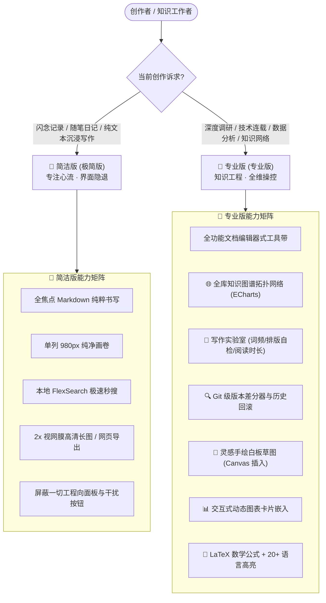

# 📐 LongPost 简洁版与专业版设计分工与能力集成白皮书

> **LongPost Workspace Dual-System Specification**  
> 版本：v3.0.3  
> 适用端：桌面客户端 (Electron) · 移动客户端 (Android Capacitor) · 网页端 (Web)

---

## 一、 背景与设计初衷

在传统写作与知识管理应用中，多数产品的模式切换仅停留在“换主题颜色”或“深浅色切换”的表面层级。然而，真实的创作者在不同的创作阶段有着截然相反的心智模型：

- **心流创作期**：用户需要绝对的纯净、极简、大留白，界面应主动“退让隐形”，不让多余的侧边栏、复杂的参数开关或技术面板打断思路；
- **知识工程期**：用户需要掌控全局，要求图谱拓扑、版本差分、词频体检、手绘草图、数据图表与格式细控等全维度专业工具触手可及。

**LongPost 拒绝表面换肤，而是从「官网原始 CSS 令牌」与「真实场景分工」出发，彻底重构出两套并存的独立骨架**：
1. **极简版**：去掉一切非必要元素，专注纯粹写作与沉浸心流；
2. **专业版**：完整工具带与结构化信息，专注知识工程与全维生产力。

---

## 二、 官方原始规范实测与令牌基准

两套设计语言的参数共用同一套设计令牌，在同一套底层代码中并存并实现一键瞬切（`Alt + M`）：

```
┌───────────────────────────┬───────────────────────────────────┬───────────────────────────────────┐
│ 维度                      │ 🍎 简洁版 (对标 apple.com / HIG)   │ 🎨 专业版 (对标 google.com / M3)   │
├───────────────────────────┼───────────────────────────────────┼───────────────────────────────────┤
│ 布局形态 (Layout)         │ 零侧栏大留白 · 880px 居中画卷      │ M3 侧边抽屉栏 + 右侧探索与热帖栏    │
│ 导航中枢 (Navigation)     │ 底部悬浮毛玻璃灵动 Dock 独占导航   │ 顶部/侧边 M3 功能带 + 底部/扩展 FAB │
│ 字体栈 (Font Family)      │ SF Pro Display / Text, 苹方, 无衬线 │ Google Sans, Product Sans, Roboto │
│ 杂志排版 (Typography)     │ 首字下沉 (Drop Caps) + 标点挤压连字│ 严谨等宽字符 + 标点常规间隔        │
│ 大标题字距 (Tracking)     │ -.022em (负字距，紧凑有力)         │ 0 (标准字距)                      │
│ 正文字距 (Body Tracking)  │ -0.015em (OpenType palt/kern)     │ +0.03125em (+0.5px，透气易读)     │
│ 行高节奏 (Line Height)    │ 精密小数 (1.2352 / 1.2857 / 1.7)  │ 黄金比例 (1.4 / 1.6 / 1.8)        │
│ 容器层级表现              │ 背景色色阶台阶 (Tonal step)，不描边 │ 1px 细线描边 + 海拔双阴影 (Elevation)│
│ 圆角阶梯 (Border Radius)  │ 6 / 10 / 12 / 18 / 980px (大胶囊) │ 4 / 8 / 12 / 16 / 28 / 9999px (固定)│
│ 数据图表 (ECharts)        │ 莫兰迪高雅调色 · 顶部 6px 圆角柱体 │ 活力主题色阶 · 结构化双轴对比     │
│ 特殊质感 (Paper Texture)  │ 宣纸暖阳微噪点 (warm-paper 护眼纹理)│ 纯净冷色/深灰卡片 (M3 Surface)    │
│ 开关控件 (Switch)         │ iOS 系统绿 #34c759 (透明本体+白滑块)│ M3 Primary 轨道 + On-Primary 滑块 │
│ 对话框形态 (Modal)        │ 18px-20px 毛玻璃抽屉 (带抓手 Handle)│ 28px 超大圆角 M3 Tonal 卡片       │
│ 品牌徽记                  │ 极简窗口标识                       │ 主题色徽标                         │
└───────────────────────────┴───────────────────────────────────┴───────────────────────────────────┘
```

---

## 三、 简洁版 vs 专业版深度分工定位

两套模式绝非“全功能”与“残废版”的区别，而是**不同创作场景下的精准分工**：



### 1. 🍎 简洁版：分工与设计细节
- **适用场景**：灵感速记、日记抒写、纯文学创作、会议速记、无干扰专注阅读；
- **保留的核心能力**：
  - 核心排版：标题（H1-H6）、正文、加粗、斜体、引用、任务清单、单图插入；
  - 导出能力：一键导出自包含单文件 Web 网页、一键导出 2x 高清无截断长图；
  - 检索能力：毫秒级本地全文搜索；
- **主动屏蔽/隐藏的复杂能力**：
  - 隐藏关系网络图谱、文本体检实验室、版本差分器、手绘白板等 4 大工程工具；
  - 隐藏右侧大纲抽屉与实时双栏对照（默认专注单栏写作）；
  - 保持工具栏极度纯净，杜绝任何视觉噪音。

### 2. 🎨 专业版：分工与设计细节
- **适用场景**：学术研究、技术文档、长篇小说架构、数据分析报告、全库知识网状梳理；
- **专属集成的生产力套件**：
  - 展开文档编辑器样式的格式工具带（Formatting Ribbon）；
  - 开放 4 大本地专属杀手级工具：图谱、实验室、版本比对、白板；
  - 开放双栏实时对照编辑、正文结构大纲导航与 ECharts 交互式活数据图表。

---

## 四、 本地优先：集成的核心能力清单

LongPost 坚持**100% 本地离线优先（Local-First）**架构。无论是极简版还是专业版，**所有功能断网完全可用，绝不向任何云端上传一行正文**。

### 1. 四大本地杀手级生产力工具（专业版专属）

| 工具 | 技术原理 | 解决的痛点 |
| :--- | :--- | :--- |
| **🌐 全库知识图谱 (Knowledge Graph)** | 基于本地 ECharts 力导向引擎，动态扫描本地所有文章的标签网络与双向关联，实时计算拓扑权重 | 摆脱孤岛式单篇文件存储，实现类似 Obsidian 的网状知识漫游；点击节点直达文章 |
| **🔬 写作实验室 (Writing Lab)** | 基于本地纯 JS 分词算法与正则诊断机，零网络依赖完成 10 维文本健康体检 | 解决长文写作中的结构失衡。提供字数/词数/段落统计、Top 10 词频分析、以及 5 项排版规范自检（标题跨级、代码块未闭合、冗余空行、超长段落预警、图片缺少 Alt 描述） |
| **🔍 版本差分器 (Version Diff)** | 类似 Git 的本地文章快照逐行比较算法（Myers Diff），自动归纳新增与删除行 | 解决写作过程中误删或改稿无法追溯的痛点；绿色高亮新增、红色高亮删除，支持单键无损回滚快照 |
| **🎨 灵感白板草图 (Inspiration Board)** | 内置轻量级 HTML5 Canvas 矢量涂鸦引擎，支持自由画笔、荧光笔、橡皮擦与粗细色阶调节 | 写作卡壳时就地手绘草图或流程构想；点击「插入文章」一键转为 Base64/PNG 嵌入正文，无须切换外部软件 |

### 2. 底层集成的 13+ 高质量开源引擎与组件

所有外部引擎均通过现代工程化构建严密打包于 `dist/client`，遵循宽松开源许可协议，严格做到零外部 CDN、零网络隐私泄漏：

1. **图表与可视化**：
   - `ECharts 6`：提供柱状图、折线图、面积图、饼图与力导向关系网络渲染，支持悬浮探针、数据过滤与自适应莫兰迪配色；
2. **文本与检索**：
   - `FlexSearch Compact`：高性能内存倒排索引，支持毫秒级中英双语全文搜索与高亮；
   - `Markdown-it 15` + 插件生态：任务列表（Task Lists）、脚注（Footnote）、定义列表（Deflist）、Emoji；
   - `PapaParse 5`：高效纯本地 CSV 数据解析器，支持表格数据一键导入图表。
3. **排版与渲染**：
   - `KaTeX 0.19`：科研级 LaTeX 数学公式渲染器，公式即敲即显；
   - `Prism.js 1.30`：覆盖 Bash, C, C++, C#, Diff, Docker, Go, Java, JSON, Python, Rust, SQL, TS, YAML 等 20+ 语言的高性能语法着色；
   - `html-to-image 1.11`：长图导出引擎，解开视口限制，按正文全高渲染 2 倍高清抗锯齿长图。
4. **移动与交互**：
   - `Hammer.js` / `swiped-events` / `pulltorefreshjs`：移动端多点触控、滑动手势与下拉刷新引擎；
   - `IndexedDB`：移动端与单文件离线网页的本地持久化数据仓库。

---

## 五、 工程质量与自动化验证护栏

为确保双模式在全平台（桌面 Electron + 移动 Android + 网页 Web）上的极端稳定性，项目建立了自动化自检防线：

- **桌面端基线自检（[`smoke-test.js`](desktop/scripts/smoke-test.js)）**：**87/87 项全绿**，覆盖长图全高渲染、标题防挤压（P2）、抽屉让位（P1）、图表销毁机制、多空间加密隔离等；
- **移动端接线自检（[`verify-mobile.js`](desktop/scripts/verify-mobile.js)）**：**108/108 项全绿**，覆盖 DOM ID 成对取用、跨端门面方法对齐、触控热区 $\ge 44\text{px}$ 无障碍达标等；
- **无障碍色对比度规范**：所有文字层级均达到 WCAG 2.1 AA 规范（正文与背景对比度 $\ge 4.5:1$），移动端底栏避免过度半透明导致的文字识别下降。

---

## 六、 总结

LongPost 的双模式系统，是用**像素级的官方设计数据**和**明确的场景分工**，为创作者打造的“双面神器”：

> **写文字时，她是干净纯粹的笔记本；**  
> **做研究时，她是工具齐备的知识工坊。**
