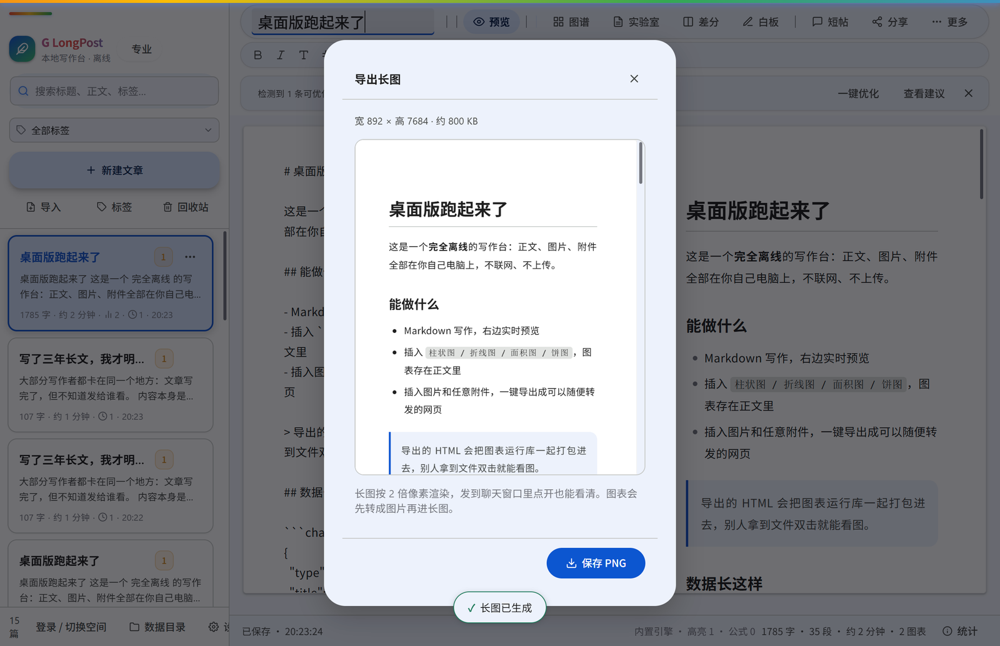
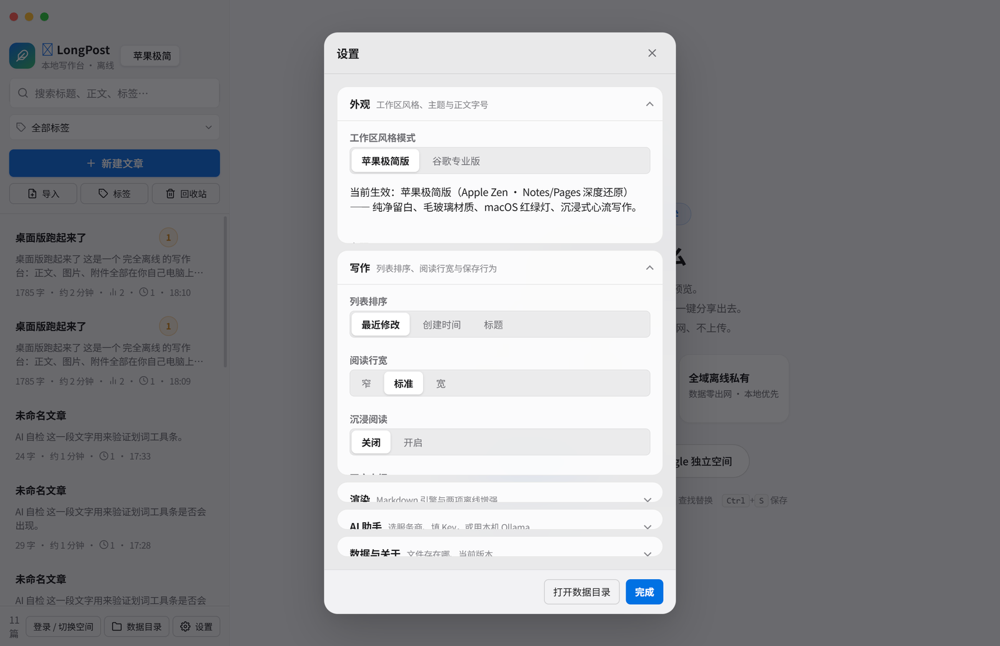
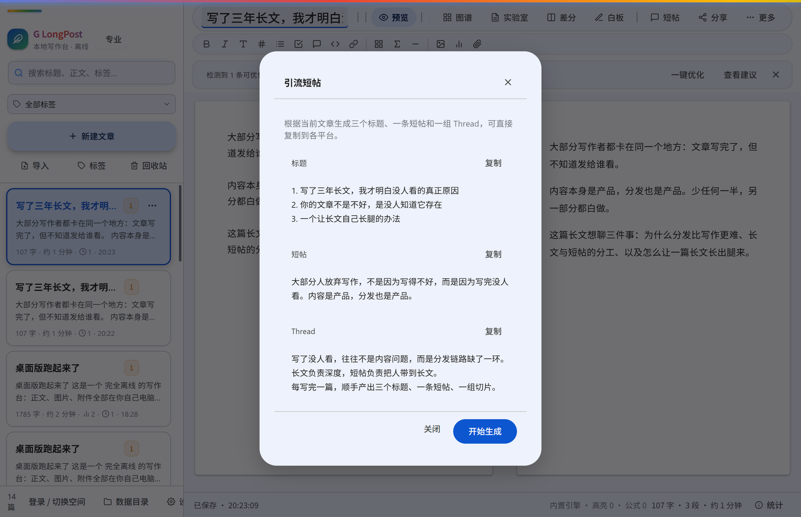

<div align="center">

# 🪶 LongPost

**下一代长文创作与社交平台 · 极简版 ↔ 专业版双工作区 · 交互式活数据图表 · 免登录公开阅读 · 零服务器离线工作台**

[](https://github.com/yeyanli543-dot/longpost/releases/tag/v3.7.0)
[](https://github.com/yeyanli543-dot/longpost/actions/workflows/desktop-release.yml)
[](https://github.com/yeyanli543-dot/longpost/actions/workflows/android-release.yml)
[](LICENSE)
[](https://react.dev)
[](https://nestjs.com)
[](https://tailwindcss.com)
[](https://www.electronjs.org)
[](https://capacitorjs.com)
[](https://echarts.apache.org)

<p align="center">
  <a href="#-多端下载">📥 多端下载</a> •
  <a href="#-双模式工作区极简版--专业版">☯️ 双模式工作区</a> •
  <a href="#-交互式图表卡片活数据可视化">📊 交互式图表</a> •
  <a href="#-杂志级排版美学与信息设计">📖 杂志级排版</a> •
  <a href="#-三端代码共享架构">🏛️ 三端共享架构</a> •
  <a href="#-安全加固与原生测试套件">🛡️ 安全与测试</a> •
  <a href="#-快速开始">🚀 快速开始</a> •
  <a href="#-开源协议">📜 开源协议</a>
</p>

---

</div>

## 📸 界面一览

| 写作台（专业版） | 设置面板 |
| :---: | :---: |
|  |  |

**长文换短帖**：写完一篇长文，直接生成三个标题、一条短帖和一组 Thread，逐块复制到 X / 即刻 / 小红书。



---

## 💡 为什么选择 LongPost？

在传统内容平台上，长文阅读通常受限于繁琐的强制登录门槛、单一静态的图文表现形式以及平台对私域流量的拦截；而在去中心化环境中，又常常面临依赖云服务宕机、数据隐私不受控的痛点。

**LongPost 采用现代全平台架构与双轨制设计**：
1. **🌐 全功能 Web 社交平台**：发短帖引流挂长文，每篇长文生成独立短码免登录分享页（如 `/p/abc12345`）。**链接转发到微信、X/Twitter 等任意平台，外部访客无需注册、无需登录，点开即可阅读全文与交互式图表**；
2. **💻 桌面工作台 & 📱 移动端**：**完全不依赖任何外部服务器**，数据 100% 留存在你的本机设备中（Local-First）。支持正文内嵌交互式图表（ECharts），一键导出自包含单文件 HTML，发出去双击就能看；
3. **☯️ 深度场景化双工作区**：首创 **🍏 极简版（HIG 纯净心流）** 与 **🔷 专业版（知识工程）**，一键瞬切，满足不同心智状态下的创作与阅读需求。

---

## <a id="-多端下载"></a>📥 多端下载 (v3.7.0 最新全平台安装包)

所有安装包均通过 GitHub Actions 自动化 CI 构建并带有防篡改校验，即下即用：

| 平台 | 安装包格式 | 下载渠道 | 说明 |
| :--- | :--- | :--- | :--- |
| **🪟 Windows** | `.exe` 安装版 / 便携版 | [**下载安装版**](https://github.com/yeyanli543-dot/longpost/releases/download/v3.7.0/LongPost.Setup.3.7.0.exe) · [**免安装便携版**](https://github.com/yeyanli543-dot/longpost/releases/download/v3.7.0/LongPost.3.7.0.exe) | 支持 Windows 10/11，便携免安装版解压双击直接运行 |
| **🤖 Android** | `.apk` 手机安装包 | [**下载 LongPost-android.apk**](https://github.com/yeyanli543-dot/longpost/releases/download/v3.7.0/LongPost-android.apk) | 手机端离线写作，固定签名密钥支持无缝覆盖升级 |
| **🧩 Chrome 扩展** | 源码目录 | [**查看扩展**](https://github.com/yeyanli543-dot/longpost/tree/main/chrome-extension) | 开发者模式加载，或随桌面版一起分发 |
| **🍎 macOS** | `.dmg` 镜像 | [**下载 LongPost-3.7.0-arm64.dmg**](https://github.com/yeyanli543-dot/longpost/releases/download/v3.7.0/LongPost-3.7.0-arm64.dmg) | 支持 Apple Silicon & Intel，首次打开右键放行 |
| **🐧 Linux** | `.AppImage` | [**下载 LongPost-3.7.0.AppImage**](https://github.com/yeyanli543-dot/longpost/releases/download/v3.7.0/LongPost-3.7.0.AppImage) | 赋予执行权限 `chmod +x` 后直接运行 |
| **📦 全部版本** | 全部安装产物 | [**GitHub Releases v3.7.0 (最新发布页)**](https://github.com/yeyanli543-dot/longpost/releases/tag/v3.7.0) | 包含所有平台的安装包、源码与校验哈希 |

---

## ☯️ 双模式工作区：极简版 ↔ 专业版

LongPost 拒绝粗暴的「换皮换色」：两套工作区是同一套底层代码上的两副独立骨架，各自有完整的间距、排版与层级规则，支持一键瞬切（快捷键 `Alt + M` 或点击底部切换器）：

```
┌───────────────────────────┬───────────────────────────────────┬───────────────────────────────────┐
│ 维度                      │ 极简版                             │ 专业版                            │
├───────────────────────────┼───────────────────────────────────┼───────────────────────────────────┤
│ 布局形态 (Layout)         │ 零侧栏大留白 · 880px 居中画卷      │ 侧边抽屉栏 + 右侧探索与热帖栏      │
│ 导航中枢 (Navigation)     │ 底部悬浮毛玻璃 Dock 独占导航       │ 顶部功能带 + 浮动主按钮 (FAB)      │
│ 排版气质 (Typography)     │ 首字下沉 + 标点挤压连字            │ 严谨等宽字符 + 标点常规间隔        │
│ 大标题字距 (Tracking)     │ -.022em（紧凑有力）                │ 0（标准字距）                     │
│ 正文字距 (Body Tracking)  │ -0.015em（OpenType palt/kern）    │ +0.03125em（透气易读）            │
│ 行高节奏 (Line Height)    │ 精密小数 (1.2352 / 1.2857 / 1.7)  │ 黄金比例 (1.4 / 1.6 / 1.8)        │
│ 容器层级表现              │ 背景色阶台阶，不描边               │ 1px 细线描边 + 双层阴影            │
│ 圆角阶梯 (Border Radius)  │ 6 / 10 / 14 / 20 / 胶囊            │ 6 / 10 / 14 / 20 / 胶囊            │
│ 数据图表 (ECharts)        │ 低饱和配色 · 顶部圆角柱体          │ 主题色阶 · 结构化双轴对比          │
│ 特殊质感 (Paper Texture)  │ 宣纸暖阳微噪点 (warm-paper)        │ 纯净冷色 / 深灰卡片               │
│ 开关控件 (Switch)         │ 系统绿 #34c759（透明本体+白滑块）  │ 主色轨道 + 对比色滑块              │
│ 对话框形态 (Modal)        │ 18–20px 毛玻璃抽屉（带抓手）       │ 28px 大圆角 Tonal 卡片            │
└───────────────────────────┴───────────────────────────────────┴───────────────────────────────────┘
```

### 1. 极简版
- **大留白居中专注阅读**：隐藏左右全部侧边栏，取消主列右侧边框，正文单列 `max-w-[880px]` 居中展布，界面主动“退让隐形”，还原纸质书般纯粹心流；
- **macOS / iPadOS 悬浮毛玻璃灵动 Dock**：位于屏幕底部的胶囊 Dock 独占全局导航，集成首页、搜索、快速撰写、通知、私信以及**微型用户账户快捷菜单**；
- **排版质感**：集成杂志级首字下沉（Drop Caps）、标点挤压与连字（`palt`/`kern`）、以及宣纸暖阳（`warm-paper`）护眼微噪点底纹。

### 2. 专业版
- **完整 Material 3 空间**：标准的 M3 侧边抽屉导航栏、右下角 Material You 扩展 FAB 浮动动作按钮（“撰写”）、右侧实时热榜与探索栏；
- **全功能格式工具带（Formatting Ribbon）**：文档编辑器风格的富文本工具带与 LaTeX 数学公式即敲即显；
- **4 大本地离线杀手级生产力工具**：
  1. 🌐 **全库知识图谱（Knowledge Graph）**：基于 ECharts 力导向拓扑引擎，扫描全库标签网络与双向引用，点击节点无缝漫游；
  2. 🔬 **写作体检实验室（Writing Lab）**：10 维文本诊断，实时字数/词频透视与 5 项排版规范自检（标题跨级、代码块未闭合、冗余空行、超长段落预警、图片缺少 Alt）；
  3. 🔍 **Git 级版本差分器（Version Diff）**：快照逐行比较算法（Myers Diff），增删高亮，一键无损回滚；
  4. 🎨 **灵感白板草图（Inspiration Board）**：HTML5 Canvas 矢量涂鸦引擎，手绘草图一键转图插入正文。

> 📖 详见技术白皮书：**[LongPost 双模式设计分工与能力集成白皮书 (DESIGN-SPEC.md)](DESIGN-SPEC.md)**。

---

## 🤖 AI 写作助手（Web / 桌面 / 安卓三端可用）

选中一段正文，工具条就会浮出来——**润色、精简、排版、续写**四个动作，边生成边显示，随时可以停。

| 能力 | 说明 |
| :--- | :--- |
| **划词即用** | 选中 ≥ 2 个字自动浮现，中文输入法拼写过程中不会打断 |
| **流式输出** | 逐字回传，可随时中止；写完再决定「替换选中」还是「插入下方」 |
| **三家模型** | OpenAI 兼容（DeepSeek / Moonshot / 自建网关）、Google Gemini、本机 Ollama |
| **本地知识库** | Web 端内置 BM25 倒排检索：写作时自动从你自己的历史长文里找相关片段作为参考上下文 |

### 三种取用方式，按优先级自动选择

| 方式 | 体验 | 谁付费 | 适用 |
| :--- | :--- | :--- | :--- |
| **① 本机 Key** | 在设置里填一次，只存在本机 | 你自己 | 桌面 / 安卓主力（离线可用），也适合不想把 Key 交给服务端的人 |
| **② 站点额度** | 登录即可用，零配置；按账号每天限次 | 站长 | 新用户想先试试；站长在 `.env` 配 `AI_SITE_KEY` 即开启 |
| **③ 账号托管** | 填一次 Key 加密存进账号，**换设备登录即用** | 你自己 | 多设备切换，又不想每台机器重填 |

优先级是 ① → ③ → ②：本机有 Key 就绝不上传，没填才用账号托管，再没有才吃站点额度。

> **密钥怎么存的**：方式 ③ 的 Key 用 AES-256-GCM 加密后写入 `user_ai_settings` 表，
> 加密密钥由服务端 `AI_KEY_SECRET`（缺省回退 `JWT_SECRET`）派生，数据库泄露也拿不到明文；
> 方式 ① 的 Key 根本不离开设备。界面上只会显示 `sk-1…cdef` 这种掩码。
>
> **桌面 / 安卓的请求链路**：由 **Electron 主进程代发**（`desktop/main.js` 的 `ai:chat` 通道），
> 渲染层跑在 `file://` 下也不受跨域限制。Web 端则走 `/api/ai/chat`（SSE 流式）或浏览器直连。
> 配置位置：**设置 → AI 助手**（桌面 / 安卓）或编辑器划词工具条右侧的齿轮（Web）。

---

### 长文换短帖

写完一篇几千字的长文，工具条上点「短帖」，模型读完全篇后给出：

1. **三个标题**：信息密度高 / 带悬念 / 口语社群风，供不同平台挑；
2. **一条短帖**：140 字以内，可直接发 X / 即刻；
3. **一组 Thread 切片**：5 条以内，每条不超过 100 字。

每块都带复制按钮。原文超长时按「开头 + 结尾」截取 6000 字送入模型，既避免上下文溢出，又保住通常位于后半段的结论。

## 🔐 站点开启 AI 公共额度（部署者看这里）

在 `.env` 里配四行即可，不配则公共额度自动关闭、只允许用户自带 Key：

```ini
AI_SITE_PROVIDER=gemini              # gemini | openai
AI_SITE_KEY=AIza...                  # 站点自己的 Key
AI_SITE_MODEL=gemini-2.5-flash       # 留空用默认模型
AI_DAILY_QUOTA=20                    # 每个登录用户每天可用次数，0 = 关闭
```

额度按「用户 + 自然日」计数，跨天自动归零；用户自带 Key 时不占用额度。
想接 DeepSeek、Moonshot 或自建 one-api 网关，把 `AI_SITE_PROVIDER=openai`、
`AI_SITE_BASE_URL` 指向对应的 `/v1` 地址即可。

---

## 📊 交互式图表卡片（活数据可视化）

在 Markdown 正文中使用 ````chart` 围栏，即可内嵌 **柱状图 / 折线图 / 面积图 / 饼图**。图表不仅是截图，更是活生生的可交互数据：

```markdown
```chart
{
  "type": "bar",
  "title": "2026年全平台内容转化率对比",
  "height": 280,
  "xAxis": ["短视频引流", "图文资讯", "长文沉淀", "互动图表"],
  "series": [
    { "name": "留存率", "data": [18, 34, 76, 92] },
    { "name": "完读率", "data": [12, 28, 68, 88] }
  ]
}
```
```

### 视觉与交互升级亮点：
- **自适应现代调色板**：浅色模式采用高雅莫兰迪色系（`#2563eb`, `#7c3aed`, `#db2777`, `#059669`），深色模式采用柔和微光色系（`#38bdf8`, `#818cf8`, `#c084fc`, `#34d399`）；
- **柱状图现代圆角**：柱体顶部统一增加 `borderRadius: [6, 6, 0, 0]`，告别生硬切角；
- **环形图优雅间隙**：饼图与环形图引入 `borderRadius: 6` 及主题自适应微隙描边；
- **双端同构还原**：React 网页端渲染、服务端直出与导出的自包含单文件离线 HTML 完全一致，悬浮探针可实时读取数值。

### 🆕 工程与数据安全增强
- **WebDAV 全量备份 / 一键恢复**：同步设置面板新增「全量备份」与「从备份恢复」，把全库文章打成单个 `longpost-backup.json` 存进你的 WebDAV；恢复采用 **合并式** 策略，本地已有的文章绝不覆盖，换机或误删时可安全找回；
- **桌面端长图落盘打通**：`platform.saveExportImage()` 补齐了「preload 通道已通、平台层未接」的断点，桌面端点「保存长图」现在会真正弹出系统保存对话框；
- **草稿防抖竞态锁**：`LocalFirstStore` 引入 `pendingDraftSnapshot` + `flushPendingSave()`，在切换草稿、读取草稿、删除草稿前强制冲刷挂起写入，彻底消除"跨文档内容互相覆盖"这一类丢稿事故；
- **自定义 AI 网关**：Gemini 配置新增 Custom Base URL，可指向自建反向代理或企业网关；
- **单一版本事实源**：新增 `shared/version.ts`，设置页、RSS/Atom 订阅源的 `<generator>` 统一从该常量读取，杜绝"界面一套版本号、安装包另一套"。

---

## 📖 杂志级排版美学与信息设计

针对中文长文排版的痛点，LongPost 在 CSS 渲染管道层进行了系统性优化：

1. **首字下沉（Drop Caps）**：长文开篇首段第一个汉字或英文字母自动呈现 3.25 倍字号下沉排版（支持通过 `.article-drop-cap` 控制）；
2. **中英文标点挤压与连字（CJK Punctuation Kerning）**：应用 OpenType `font-feature-settings: "palt", "kern"` 与 `text-rendering: optimizeLegibility`，消除标点过度留白，视觉排版整齐紧凑；
3. **盘古之白排版算法（Pangu Spacing）**：智能在中英文、数字与百分比之间保持规范间距，并严格保护行内代码与代码块不被篡改；
4. **宣纸暖阳微纹理（Warm Paper）**：在暖纸模式下注入 `radial-gradient` 极微噪点底纹与柔和纸质背景色，彻底告别单调纯白，提供沉浸温润的阅读体验。

---

## 🏛️ 三端代码共享架构

同一个代码仓库，通过现代工程化解耦，完美支撑从**本地离线写作端**到**高并发公网社交平台**的全部场景：

```
┌────────────────────────────────────────────────────────────────────────┐
│                              LongPost 仓库                             │
├─────────────────────┬───────────────────────────┬──────────────────────┤
│    💻 桌面版 (desktop/)   │      📱 手机版 (mobile/)    │    🌐 Web版 (client+server)  │
├─────────────────────┼───────────────────────────┼──────────────────────┤
│ 运行时: Electron 44   │ 运行时: Capacitor 8 Android│ 运行时: Node 22 + React 19 │
│ 渲染层: desktop/renderer │ 渲染层: desktop/renderer │ 渲染层: client/ → dist/client │
│ 存储: 本地 JSON + 附件  │ 存储: 本地 IndexedDB       │ 存储: PostgreSQL + Drizzle │
│ 网络: 纯离线零联网    │ 网络: 纯离线零联网        │ 网络: JWT鉴权 + Socket.IO  │
│ 适用: 个人深度写作/归档 │ 适用: 随身速记/无障碍阅读 │ 适用: 团队社区/公网分发推广│
└─────────────────────┴───────────────────────────┴──────────────────────┘
```

- **双轨渲染层，各司其职**：
  - **Web 社交平台**：`client/`（React 19 + Tailwind CSS 4）构建到 `dist/client`，由 NestJS 托管并做阅读页直出；
  - **桌面 / 手机写作台**：共用 `desktop/renderer/` 这套零依赖原生 JS 渲染层（沙箱化、纯离线，数据只进本机磁盘或 IndexedDB），Capacitor 的 `webDir` 也指向它。
  - 两条轨道共享 `shared/` 里的类型、图表 DSL 与同步协议，但**不共享 UI 代码** —— 前者要联网做社区，后者要求断网可用，混成一份反而两边都做不好。
- **极致轻量打包**：移动端通过 Capacitor 编译为原生 APK，桌面端由 electron-builder 产出自包含安装包与免安装便携版。

---

## 🛡️ 安全加固与原生测试套件

项目内置针对生产级网络攻击与边界场景的自动化安全防护，原生测试套件包含 **9 个专业套件、37 项测试用例全部通过（~570ms 极速验证）**：

```bash
npm test
# 运行 node --test test/*.test.mjs
```

1. **DFA 敏感词高速过滤与反伪装穿透**：基于确定有穷自动机（DFA），毫秒级扫描长文本，抵御空格、特殊符号混杂及同音变形穿透，支持平滑星号脱敏；
2. **CSV 导出公式注入阻断（Formula Injection / DDE）**：自动转义 `=`、`+`、`-`、`@` 等危险公式前缀，防止导出的表格在 Excel/WPS 中触发命令执行；
3. **复合键游标深度分页（Compound Keyset Cursor）**：基于 `(score, createdAt, id)` 构造防篡改 Base64 游标，彻底规避传统 Offset 分页的性能雪崩与浮点时间精度漂移；
4. **盘古之白排版算法回归保护**：严格保护多行代码块、行内反引号与 Markdown 图片链接不受文本美化算法干扰；
5. **异形屏安全区与前摄挖孔避让**：精确计算 Dynamic Island、前摄挖孔及横屏模式下的系统安全边距（`--custom-punch-hole-offset`）；
6. **防暴力破解与 JWT 瞬时吊销（Token Versioning）**：密码错误指数退避锁定，修改密码或登出时递增 `tokenVersion`，实现分布式无状态 JWT 的秒级即时失效；
7. **数据完整性与多态级联回归（Data Integrity & Cascade）**：`GREATEST(0, val - 1)` 防负数下溢、禁止自关注、父评论与软删除一致性校验，模拟点赞、转发、评论、通知的多态安全级联清理；
8. **全生态分发与数字第二大脑（Ecosystem Syndication）**：Obsidian 标准 YAML Frontmatter 与 `[[WikiLink]]` 导出适配、微信公众号原生 CSS 样式内联引擎，单键一键排版直通微信后台；
9. **RSS 2.0 & RFC 4287 Atom 1.0 标准聚合 Feed**：自动生成严格合规的 XML 订阅源，支持主流阅读器（NetNewsWire, Reeder, Follow, Feedly）即刻抓取。

---

## 🔌 v3.1 / v3.2 生态连接

把入口从「我坐下来写」扩到「我在哪都能开始写」。

| 入口 | 说明 |
| :--- | :--- |
| **Chrome 扩展** | 右键保存整页 / 只存选区 / 从剪贴板保存；默认标签；最近剪藏 |
| **书签小工具** | 一段 `javascript:` 代码，任意网页一点即存 |
| **命令行** | `node scripts/longpost-cli.cjs "内容"`，端口与令牌自动读取 |
| **Windows「发送到」** | 设置里一键加入，任意文件右键 → 发送到 → LongPost |
| **Obsidian 插件** | 把最近剪藏导入 vault，带 `source` frontmatter |
| **任意脚本** | `POST /clip`，见 [剪藏 API](docs/CLIP-API.md) |

本地桥的边界：

- 只监听 `127.0.0.1`，端口由系统分配；
- 每个请求都要 `X-LongPost-Token`，恒定时间比较；
- 60 秒 40 次限流、512 KB 体积上限；
- 放行 Chrome 的 Private Network Access，否则 https 页面访问不到本机（这个坑踩过）。

---

## 🚀 快速开始

### 💻 方案 A：直接运行桌面写作端（零配置）

```bash
# 1. 编译前端产物
npm run build:client

# 2. 进入桌面目录并启动
cd desktop
npm install
npm start
```

---

### 🌐 方案 B：启动 Web 全栈开发服务

#### 运行前置条件
- **Node.js** >= 18（推荐 22+）
- **PostgreSQL** 数据库实例

```bash
# 1. 根目录安装依赖
npm install --ignore-scripts

# 2. 复制环境变量配置文件
cp .env.example .env
# 编辑 .env，填入 DATABASE_URL 与 JWT_SECRET

# 3. 运行自动化测试
npm test

# 4. 并行启动前端与后端开发服务器
npm run dev
```

---

### 📱 方案 C：构建 Android 手机端 APK

```bash
# 1. 构建前端现代产物
npm run build:client

# 2. 同步至 Capacitor Android 工程
cd mobile
npm install
npm run sync:android

# 3. 编译 Debug APK（需本机安装 JDK 与 Android SDK）
npm run apk
```

编译出的安装包位于：`mobile/android/app/build/outputs/apk/debug/app-debug.apk`。

---

## 🛠️ 技术栈总览

| 维度 | 技术栈方案 |
| :--- | :--- |
| **前端开发** | React 19 · TypeScript 5.9 · Vite 8 · Tailwind CSS 4 · Radix UI · Framer Motion · Lucide Icons |
| **后端开发** | NestJS 12 · TypeScript · Drizzle ORM · PostgreSQL · Socket.IO · SWC 编译器 |
| **图表引擎** | Apache ECharts 6 · 自适应莫兰迪色盘 · 同构 DSL 卡片解析器 |
| **桌面客户端** | Electron 44 · 独立本地文件存储与数据隔离 · electron-builder |
| **移动客户端** | Capacitor 8 (Android) · 挖孔屏自适应安全边距 · 独立离线密钥签名 |
| **测试与质量** | Node.js 原生 Test Runner (`node --test`) · 9 个套件 37 项安全与算法测试用例 |

---

## 📁 目录结构导览

```text
├── client/              # 前端 React 19 应用
│   ├── src/
│   │   ├── pages/       # 发现流、长文阅读、编辑器、搜索、设置、视频会议室等页面
│   │   ├── components/  # Layout 布局（极简悬浮 Dock / 专业侧边抽屉）、ActionButtons、图表等
│   │   ├── hooks/       # 鉴权状态、工作区模式切换、主题切换 hooks
│   │   └── api/         # Axios 封装与后端 API 契约层
│   └── index.html       # 单页应用入口
├── server/              # 后端 NestJS 12 核心服务（Express 5）
│   ├── modules/         # 业务模块 (auth / articles / posts / meetings / admin ...)
│   ├── database/        # Drizzle ORM 数据模型 (schema.ts) 与迁移脚本
│   └── common/          # 安全过滤器、Markdown 与 XSS 防护解析器
├── desktop/             # Electron 桌面应用 (独立无后端写作端)
│   ├── main.js          # Electron 主进程入口（加载 renderer/index.html，并代理 AI / WebDAV 出站请求）
│   ├── preload.js       # 安全隔离的 Preload 桥接脚本
│   └── lib/             # 本地数据仓库、HTML 导出引擎
├── mobile/              # Capacitor 8 移动端安卓工程
│   └── capacitor.config.json # WebDir 指向 ../desktop/renderer
├── shared/              # 前后端共享类型与图表卡片 DSL 规范 (chart-card.ts)
├── test/                # 21 个套件 107 项原生单元测试（直连生产代码，不经编译）
└── .github/workflows/   # 云端自动化 CI/CD (多端编译与 Release 发布)
```

---

## 🚀 v3.0 个人发布引擎

v3.0 不再只回答「怎么写」，开始回答「写完之后」。

| 能力 | 说明 |
| :--- | :--- |
| **邮件订阅** | 双向确认订阅、发布即推送、一键退订；支持 Resend / SMTP / console 三种通道 |
| **动态分享图** | 每篇文章自动生成 1200×630 的 OG 卡片，分享出去不再是一条灰链接 |
| **整库迁入** | 选一个 Obsidian / Markdown 文件夹，批量导入，目录变成标签，同名默认跳过 |
| **整站迁出** | 一键导出成可直接托管到 GitHub Pages 的静态站（相对链接，放任意子路径都能跑） |

配置订阅只需三个变量：

```ini
NEWSLETTER_ENABLED=true
MAIL_PROVIDER=resend        # 或 smtp / console
RESEND_API_KEY=re_...       # smtp 则用 SMTP_HOST / SMTP_USER / SMTP_PASS
SITE_URL=https://你的域名     # 影响确认信链接、RSS 与分享图域名
```

---

## 🧩 浏览器扩展（Chrome / Edge）

`chrome-extension/` 里是一个 Manifest V3 扩展：右键保存整页、只存选中文字，内容直接进本地 LongPost。

安装：`chrome://extensions` → 开发者模式 → 加载已解压的扩展程序 → 选该目录；然后在 LongPost 设置里打开「Chrome 剪藏」并复制配对码。

---

## 📚 文档

| 文档 | 内容 |
| :--- | :--- |
| **[技术白皮书](docs/WHITEPAPER.md)** | 架构、模块地图、安全模型、质量工程、部署与路线图的完整说明（另有 [HTML](docs/whitepaper.html) / [PDF](docs/whitepaper.pdf) 版本） |
| **[产品报告](docs/PRODUCT-REPORT.md)** | 产品定位、功能全景、技术架构、版本演进、工程质量、安全与隐私、性能数据、已知限制、路线图 |
| **[使用说明](docs/USER-GUIDE.md)** | 安装、界面导览、写作与快捷键、AI 助手配置、导出分享、WebDAV 同步、双工作区、自建部署、排错 |
| **[优化报告](docs/OPTIMIZATION-REPORT-2026-10.md)** | 2026-10 那轮全面体检记录：问题定位、修复内容、验证数据 |
| **[剪藏 API](docs/CLIP-API.md)** | 本地桥接口：任何脚本/扩展都能把内容送进 LongPost |
| **[生态接入](docs/ECOSYSTEM.md)** | 命令行、Raycast、Alfred、PowerToys 的接法 |
| **[Obsidian 插件](obsidian-plugin/README.md)** | 把最近的剪藏导入 vault（带来源 frontmatter） |
| **[设计规范](DESIGN-SPEC.md)** | 两套工作区的设计分工与实现细节 |
| **[开发约定](AGENTS.md)** | 目录职责、版本号规则、测试写法、同步协议、出站安全 |

---

## 🚀 部署（Web 端）

三种路子，按省事程度排序。**桌面端 / 安卓不需要部署**——它们是本地应用，装完就能用。

### 前置：必须先配的几项

```bash
cp .env.example .env
```

| 变量 | 为什么必须 |
| :--- | :--- |
| `JWT_SECRET` | 不填就用默认值，等于谁都能伪造登录态 |
| `OWNER_EMAIL` | 不填会创建 `admin@longpost.com / admin123` 的默认管理员 |
| `DATABASE_URL`（或 `SUDA_DATABASE_URL`） | PostgreSQL 连接串 |
| `UPLOAD_DIR` | 必须是**持久化目录**，否则重新部署会丢图片和附件 |

AI 助手是可选功能：不配 `AI_SITE_KEY` 就只允许用户自带 Key。

---

### 方式一：直接跑（最快验证）

```bash
npm ci --legacy-peer-deps
npm run build
NODE_ENV=production node dist/server/main.js
```

适合本机试跑。**不适合长期跑**：进程挂了不会自动重启。

---

### 方式二：PM2（单机长期运行）

```bash
npm i -g pm2
npm ci --legacy-peer-deps && npm run build
pm2 start ecosystem.config.cjs
pm2 save && pm2 startup     # 开机自启
```

> ⚠️ **必须单实例**。站内私信和会议信令走 Socket.IO，项目没有装 Redis adapter，
> 多实例会导致「消息有时收不到」「会议里看不到人」。真要用多核，
> 先接 `@socket.io/redis-adapter`，再把 `ecosystem.config.cjs` 里的 `instances` 改成 `max`。

常用命令：

```bash
pm2 logs longpost      # 看日志
pm2 restart longpost   # 发版后重启
pm2 monit              # 资源占用
```

---

### 方式三：Docker Compose（推荐，连数据库一起起）

```bash
# 先在 .env 里补一行数据库密码
echo "POSTGRES_PASSWORD=$(openssl rand -hex 16)" >> .env

docker compose up -d --build
docker compose logs -f app
```

起来之后访问 `http://localhost:3000`（端口可用 `APP_PORT` 改）。

| 卷 | 内容 |
| :--- | :--- |
| `pgdata` | PostgreSQL 数据 |
| `uploads` | 用户上传的图片与附件 |

备份就备份这两个卷：

```bash
docker compose exec db pg_dump -U longpost longpost > backup-$(date +%F).sql
docker run --rm -v longpost_uploads:/data -v "$PWD":/backup alpine tar czf /backup/uploads.tar.gz -C /data .
```

镜像内置 `HEALTHCHECK`，会打 `/api/site-settings` 探活；`docker compose ps` 看到 `healthy` 即代表数据库连接与路由都正常。

---

### 反向代理（Nginx 片段）

```nginx
server {
  listen 80;
  server_name your-domain.com;
  client_max_body_size 30m;

  location / {
    proxy_pass http://127.0.0.1:3000;
    proxy_http_version 1.1;
    proxy_set_header Host $host;
    proxy_set_header X-Real-IP $remote_addr;
    proxy_set_header X-Forwarded-For $proxy_add_x_forwarded_for;
    proxy_set_header X-Forwarded-Proto $scheme;

    # Socket.IO 必须放行 Upgrade
    proxy_set_header Upgrade $http_upgrade;
    proxy_set_header Connection "upgrade";
    proxy_read_timeout 600s;
  }
}
```

配上反向代理后，记得在 `.env` 里设置 `CORS_ORIGIN=https://your-domain.com`。

---

## 📜 开源协议

本项目基于 [MIT 许可证](LICENSE) 开源。欢迎提交 Issue、Fork 并发起 Pull Request！

<div align="center">
  <sub>Built with ❤️ by yeyanli543-dot · 2026</sub>
</div>
